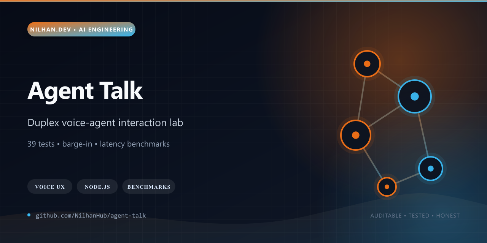
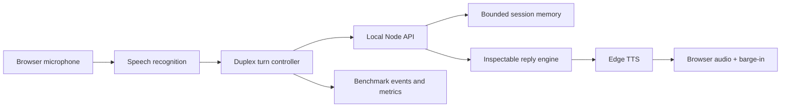

# Agent Talk

[](https://github.com/NilhanHub/agent-talk/actions/workflows/ci.yml)
[](LICENSE)
[](package.json)



Agent Talk is a local voice-agent interaction lab for studying the difficult parts of spoken interfaces: microphone state, barge-in, stale-response suppression, turn integrity, short-term conversational memory, and reliable text-to-speech playback.

It deliberately keeps the conversation engine local and inspectable. That makes the repository useful as an engineering test bed for duplex voice UX without hiding timing and state problems behind a hosted model API.

## Why it stands out

- Browser speech recognition and Microsoft Edge TTS are joined through a small Node.js service.
- The controller aborts superseded requests, ignores stale replies, recovers from recognition failures, and handles autoplay fallback.
- A deterministic 20-round benchmark catalog measures latency, overlap, missing replies, and duplicate playback starts.
- Short per-session memory supports follow-up references while an LRU policy bounds server memory.
- The public release is backed by **39 passing product tests**.



## Quick start

Requirements:

- Node.js 22+
- the `edge-tts` CLI
- Microsoft Edge or Google Chrome for browser speech recognition

```bash
npm ci
npm test
npm start
```

Open `http://localhost:3000`. To use another port in PowerShell:

```powershell
$env:PORT = 3217
npm start
```

## Repository map

- `src/` — server services, turn logic, memory, metrics, and browser controller modules
- `public/` — dependency-light browser interface
- `scripts/benchmark/` — repeatable benchmark rounds and campaign analysis
- `test/` — API, controller, speech, memory, route, and benchmark tests

## Verification

```bash
npm ci
npm test
```

The test suite does not require a microphone or external model. Live speech synthesis requires the locally installed `edge-tts` CLI.

## Maturity and boundaries

Agent Talk is an engineering prototype, not a hosted voice service. Browser speech-recognition support varies by browser, Edge TTS is a machine dependency, and the included reply engine is intentionally deterministic rather than represented as a production LLM. The benchmark harness and duplex-control logic are the portfolio focus.

See [SECURITY.md](SECURITY.md), [CONTRIBUTING.md](CONTRIBUTING.md), and [RIGHTS.md](RIGHTS.md) before deploying or extending it.
